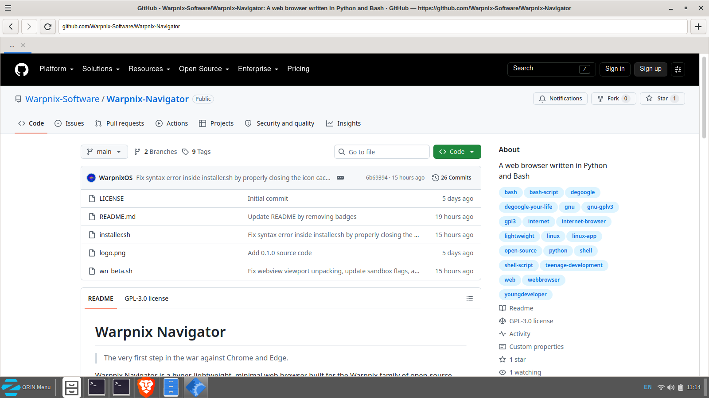

# Warpnix Navigator

> The very first step in the war against Chrome and Edge.


Warpnix Navigator is a hyper-lightweight, minimalist, deGoogled web browser built for the Warpnix family of open-source software (including [WarpnixOS](https://github.com/Warpnix-Software/WarpnixOS)). Built with **Python**, **Bash**, **GTK3**, and **WebKit**, it strips away mainstream browser bloat (I'm lookin' at you, Chrome!) for a fast, system-native experience.

---

## Preview



---

## Why Warpnix Navigator?

- **Fast to start, light to run.** Native GTK3 and WebKit2GTK keep idle memory usage under 200 MB.
- **Private by default.** Ads and trackers are blocked, and camera, microphone, and location requests are denied automatically.
- **No Google required.** Qwant is the default search engine, with a large built-in catalogue to choose from.
- **Your data stays yours.** History, bookmarks, and settings are stored locally with no telemetry, accounts, or Warpnix servers.
- **Easy to move to.** The Migration Wizard imports history, bookmarks, and search-engine preference from the browser you already use.

## Features

### Browsing
- Tabbed browsing with session restore for the last closed tab.
- Built-in bookmarks library with HTML export.
- A large search-engine chooser with popular, private, metasearch, AI, and specialty engines.
- Configurable homepage with a built-in search box.
- Built-in **Oceanic Blue** and **Forest Night** themes, plus custom color themes.
- Haiku-style page-load error screen with a retry link.

### Privacy and security
- WebKit content-filter based ad and tracker blocking.
- Optional cosmetic filtering for leftover ad placeholders.
- Editable custom blocklist in Settings.
- Pop-up blocking.
- Automatic denial of camera, microphone, and geolocation requests.

### Migration and setup
- Migration Wizard for Firefox, LibreWolf, Waterfox, Chrome, Chromium, Brave, Edge, Vivaldi, and Opera.
- Netscape-format bookmarks HTML import for any other browser.
- Graphical installer that adds a command-line launcher, application-menu entry, and icon when `logo.png` is available.
- GUI uninstaller that preserves your settings and history.

### Platform support
- Linux and BSD: FreeBSD, OpenBSD, NetBSD, and DragonFly BSD.
- Native GTK3 and WebKitGTK 4.1 on both platforms.
- Platform-aware user agent and diagnostics.

---

## Installing

Warpnix Navigator supports **Linux** and **BSD** (FreeBSD, OpenBSD, NetBSD, and DragonFly BSD).

### Download a release

Prebuilt archives are kept in the [`releases/`](releases/) folder:

- Linux: [`releases/2026.11.0/Linux/Warpnix-Navigator-2026.11.0-Linux.zip`](releases/2026.11.0/Linux/Warpnix-Navigator-2026.11.0-Linux.zip)
- BSD: [`releases/2026.11.0/BSD/Warpnix-Navigator-2026.11.0-BSD.zip`](releases/2026.11.0/BSD/Warpnix-Navigator-2026.11.0-BSD.zip)

### Requirements

- Python 3
- GTK 3
- WebKit2GTK 4.1 (WebKitGTK 4.1 on BSD)
- Bash
- Zenity (optional, for the About dialog)

### Recommended: graphical installer

```bash
git clone https://github.com/Warpnix-Software/Warpnix-Navigator.git
cd Warpnix-Navigator
./installer/installer.sh
```

The installer copies the browser to `~/.local/share/warpnix-navigator`, creates a `warpnix-navigator` launcher in `~/.local/bin`, and adds an application-menu entry. No root access is required.

### Run without installing

```bash
git clone https://github.com/Warpnix-Software/Warpnix-Navigator.git
cd Warpnix-Navigator
chmod +x wn_beta.sh
./wn_beta.sh
```

### Install dependencies by distribution

#### Debian / Ubuntu / Linux Mint
```bash
sudo apt install python3 python3-gi python3-gi-cairo gir1.2-gtk-3.0 gir1.2-webkit2-4.1 zenity
```

#### Fedora / RHEL
```bash
sudo dnf install python3 python3-gobject gtk3 webkit2gtk4.1 zenity
```

#### Fedora Atomic
```bash
rpm-ostree install python3 python3-gobject gtk3 webkit2gtk4.1 zenity
```

#### Arch Linux
```bash
sudo pacman -S python-gobject python-cairo gtk3 webkit2gtk-4.1 zenity
```

#### FreeBSD
```bash
sudo pkg install python3 py311-gobject3 gtk3 webkit2gtk41 zenity
```

Replace `py311` with the package suffix matching your installed Python version (for example `py313`).

#### OpenBSD
```bash
sudo pkg_add python3 py3-gobject3 gtk+3 webkitgtk41 zenity
```

#### NetBSD
```bash
pkgin install python3 py-gobject3 gtk3 webkit-gtk41 zenity
```

Package names vary between BSD releases. If a name is unavailable, search your ports or packages tree for `gobject3`, `gtk3`, and `webkit 4.1`.

### Uninstall

```bash
./uninstall.sh
```

The uninstaller removes the browser files, launcher, menu entry, and icon. Your settings, history, and bookmarks in `~/.config/warpnix-navigator` are preserved.

---

## Using Warpnix Navigator

1. Type a URL in the address bar, or type a search phrase and press Enter.
2. Open **Settings** to change the search engine, theme, ad-blocking options, or the custom blocklist.
3. Open **Settings → Migration Wizard** to import history and bookmarks from another browser.
4. Open **Bookmarks** to browse, open, or export your saved pages.

## Keyboard Shortcuts

| Shortcut | Action |
|---|---|
| `Ctrl` + `L` | Focus and select the address bar |
| `Ctrl` + `T` | Open a new tab |
| `Ctrl` + `W` | Close the active tab |
| `Ctrl` + `R` | Reload the page |
| `Ctrl` + `Shift` + `T` | Reopen the most recently closed tab |
| `Alt` + `T` | Open a new tab |
| `Alt` + `W` | Close the active tab |
| `Alt` + `R` | Reload the page |
| `Alt` + `Left Arrow` | Go back |
| `Alt` + `Right Arrow` | Go forward |

---

## Release Notes

**Latest release: 2026.11.0. Added bookmarks, an ad blocker, and a migration wizard.**

### 2026.11.0

- Added the built-in ad and tracker blocker with cosmetic filtering, pop-up blocking, and an editable custom blocklist.
- Added the Migration Wizard for Firefox-based and Chromium-based browsers, plus bookmarks HTML import.
- Added the bookmarks library and HTML export.
- Added the expanded search-engine chooser, opened in its own window.
- Added BSD support for FreeBSD, OpenBSD, NetBSD, and DragonFly BSD.
- Added downloadable Linux and BSD release archives.
- Added a scrollable Settings window.
- Added the GUI uninstaller with confirmation; settings and history are preserved.
- Added the Haiku-style page-load error screen with a retry link.
- Added Oceanic Blue and Forest Night themes.
- Added an About dialog using Zenity when available, with a GTK fallback.
- Improved address-bar search encoding.
- Fixed missing logos breaking desktop-entry creation.

## Roadmap

Still planned:
- General bug fixes and reliability improvements.
- Performance improvements for older hardware.
- Video-streaming performance improvements.
- Further Settings-menu polish.

Longer-term goals:
- Explore **macOS** support and improve portability.
- Explore BSD support improvements and broader testing.
- Investigate Windows, ReactOS, and Haiku support.

---

## Contributing

Bug reports and feature requests are welcome. Open an issue or submit a pull request at [Warpnix-Software/Warpnix-Navigator](https://github.com/Warpnix-Software/Warpnix-Navigator).

## Commercial Use and License

Warpnix Navigator is free software licensed under the **GNU General Public License v3.0**. You may use, modify, and redistribute it, including for commercial purposes, under the terms of the GPL-3.0. See [LICENSE](LICENSE) for the full text.

Warpnix Navigator is provided **without warranty**, as described in the license.

---

## Find me on YouTube

[@WarpdevOfficial](https://www.youtube.com/@WarpdevOfficial)

### Thanks for using Warpnix Navigator!
